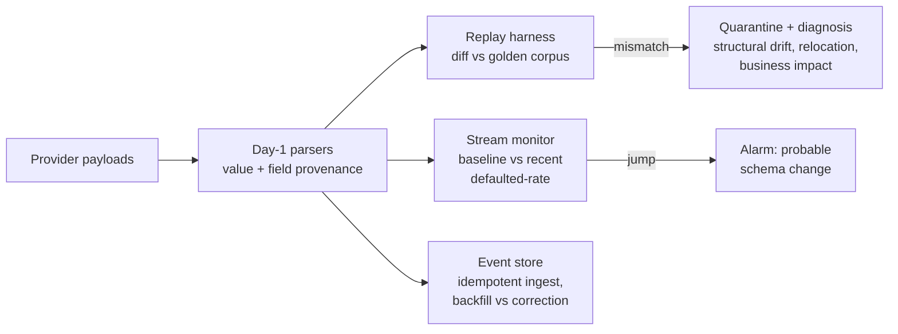

# Replay Assurance

[](https://github.com/LakshyaBetala/replay-assurance/actions/workflows/ci.yml)


[](LICENSE)

**Execution success ≠ canonical correctness.** A parser can run cleanly for months and quietly produce the wrong numbers.

Replay Assurance catches the failure where an upstream provider changes its payload shape, your parser keeps running without an error, and a usage or cost number silently drops to zero on every dashboard downstream. Usually a customer notices before the engineers do.

```
Claude       exec 100.0%   canonical 37.4%    <- parser never crashed. it was just wrong.
OpenAI       exec 100.0%   canonical 99.7%
Cursor       exec 100.0%   canonical 100.0%   <- additive-only drift; correctly unharmed
Perplexity   exec 100.0%   canonical 50.0%
Gemini       exec 100.0%   canonical 49.3%
```

Every number above is computed by the harness on a seeded corpus, so it is identical on every run. Nothing is hardcoded.

**In 30 seconds**
- Parsers report **how** they got each field (resolved, coerced, null, invalid or missing), not just the value.
- A **replay harness** checks parsers against a golden corpus in CI.
- An **oracle-free monitor** watches live traffic and alarms when a money field suddenly starts defaulting. It needs no expected values at all.
- The monitor's own precision and recall are **measured** against the confounders that fool a naive threshold.
- `replay-check` runs the monitor on **your own JSONL stream** and exits non-zero on drift, so CI or a cron job can gate on it.

---

## The failure mode

A vendor ships an update. `tokens` moves three levels deeper to `usage.total_tokens`. Nothing throws. A parser written as `payload.get("tokens", 0)` now reads `0`, forever, and that tool's cost silently drops to zero. Exception monitoring stays green. Schema validation, if there is any, stays green. The dashboard is just wrong.

The parser is the easy part. The hard part is the machinery that proves the parser is still *correct* after the world changed underneath it.

The same failure shows up anywhere code reads data it doesn't control:
- **LLM usage and cost tracking**: provider response formats change (Claude splits `input_tokens` and `output_tokens`; Gemini nests `usageMetadata.totalTokenCount`).
- **Scraping**: a site changes its layout and the extractor returns empty fields instead of failing.
- **Vendor webhooks and SaaS APIs**: a field is renamed or nested, and ETL keeps loading defaults.

## How it works



### One signal is not enough

There are **two complementary detectors**, because each covers the other's blind spot:

| | Needs an oracle? | Catches | Used in |
|---|---|---|---|
| **Replay harness** | Yes (golden corpus) | Anything, including type drift that still yields a plausible value | CI: prove a fix for one provider didn't regress five others |
| **Stream monitor** | **No** | A field moved or disappeared, the day it ships | Production: on live traffic, with nothing to diff against |

The monitor answers the obvious objection, *"you only catch drifts you scripted into your corpus"*: it doesn't use the corpus at all. Parsers emit **field provenance**. For every field, they record whether the value was `RESOLVED`, `COERCED` (present but type-cast), `NULL`, `INVALID` (present but malformed) or `MISSING`. The monitor alarms when a money field's defaulted-rate jumps for a provider:

```
[ALARM] tokens on gemini: 0% -> 100% defaulted -- probable schema change
[ALARM] cost on perplexity: 0% -> 100% defaulted -- probable schema change
[ALARM] cost on claude: 0% -> 84% defaulted -- probable schema change
[ALARM] tokens on claude: 16% -> 98% defaulted -- probable schema change
```

(Output of `make demo` on the seeded corpus: each alarm is a jump from the baseline window to the recent window.)

That signal exists on a stream of *one* provider's live traffic, with no expected value anywhere. That's what catches the move before the customer does.

### Measuring the detector, not just the disease

A high missing-rate isn't a schema change; some fields are just often empty. So the monitor alarms on a *jump* (baseline window vs recent window), not an absolute level. [`evaluation.py`](parser_assurance/evaluation.py) measures it against the confounders that fool a naive threshold:

```
scenario          truth       change-detector   naive >5%
drift_cost        cost        cost              cost
drift_tokens      tokens      tokens            tokens
partial_rollout   cost        cost              cost
benign_variance   (no drift)  -                 cost   <- naive false positive
clean             (no drift)  -                 -
low_traffic       (no drift)  -                 cost   <- naive false positive

change-detector : precision 100.0%  recall 100.0%  false-positives 0  false-negatives 0
naive >5%       : precision  60.0%  recall 100.0%  false-positives 2  false-negatives 0
```

These scenarios are synthetic and small, so 100% here means "handles these known confounders", not "perfect in production".

## Quickstart

The runtime has **zero dependencies** (stdlib only); `pip install` is just for the test runner and the console scripts.

```bash
pip install -e ".[dev]"      # or: make install
make demo                    # generate the seeded corpus + run the end-to-end story
make test                    # 13 tests: the thesis, every store invariant, and the CLI
```

Without make:

```bash
python -m parser_assurance.scripts.generate_corpus   # seeded: identical numbers every run
python -m parser_assurance                           # full demo (also the smoke test; exits non-zero on any crash)
pytest
```

Without generating the corpus, everything still runs against the committed **real payload fixtures** (`parser_assurance/data/corpus/*/v_real/`).

## Run it on your own traffic: `replay-check`

Write your payloads as JSON Lines, oldest first, one per line:

```json
{"provider": "claude", "payload": {"id": "msg_001", "tokens": 512, "billing_cost": 0.0015, "timestamp": "..."}}
```

Or pass `--provider claude` and put the bare payload on each line.

```bash
replay-check examples/claude_drift.jsonl
```

```
replay-check: oracle-free drift monitor
  claude          60 events   tokens defaulted  50.0%  cost defaulted   0.0%
[ALARM] tokens on claude: 0% -> 100% defaulted -- probable schema change
```

[`examples/claude_drift.jsonl`](examples/claude_drift.jsonl) holds 60 events. Halfway through, `tokens` moves to `usage.total_tokens`, and nothing in the stream says so. On the first 30 events alone, `replay-check` reports `No drift alarms.` and exits 0.

| Exit code | Meaning |
|---|---|
| `0` | No drift alarm |
| `1` | At least one money field shows a probable schema change |
| `2` | The input could not be read, or had nothing parseable |

Other options: `--json` for machine-readable output, `-` to read stdin, and `--min-events`, `--jump`, `--min-recent` and `--window` to tune sensitivity. Malformed lines and unknown providers are counted and reported, never fatal, so one corrupt record can't hide drift in the rest.

## Use it as a library

```python
from parser_assurance.parser import get_parser
from parser_assurance.replay import Monitor

monitor = Monitor()                       # same defaults as replay-check
parser = get_parser("claude")

for payload in incoming_payloads:         # your stream, oldest first
    event = parser.parse(payload)         # value + per-field provenance
    if event.silent_risk():               # a money field fell back to a default
        log.warning("defaulted fields: %s", event.status_dict())
    monitor.observe(parser.provider, event.field_status)

for alarm in monitor.alarms():
    page_on_call(alarm["signal"])
```

To support a new provider, subclass `BasePayloadParser` in [`parser.py`](parser_assurance/parser.py) and pull each field with `extract(payload, "dotted.path", default, coerce=...)`. Provenance comes for free.

## What's real, what's synthetic

The full account of the data is in [`CORPUS_PROVENANCE.md`](parser_assurance/data/CORPUS_PROVENANCE.md). Short version:

- The 1,000-payload corpus is **synthetic**, generated from public provider schemas with deliberately injected drift. It exercises the *mechanism*; it can't contain a drift nobody anticipated.
- The fixtures under `v_real/` are **real response shapes** from public provider docs (for example Claude's `usage.input_tokens`/`output_tokens` split and Gemini's `usageMetadata.totalTokenCount`). The generator never produces these shapes, so they're the honest test of whether the system catches a surprise. It does: the OpenAI real fixture is the only reason OpenAI reads 99.7% and not 100%.
- `examples/claude_drift.jsonl` is synthetic too, regenerated by [`examples/make_example_stream.py`](examples/make_example_stream.py).

## Four invariants it gets right

1. **Silent failure is self-reported.** Provenance turns "the number is wrong" into "tokens went from 0% to 100% `MISSING` on Gemini traffic", which is detectable without an oracle. ([`canonical.py`](parser_assurance/canonical.py))
2. **Relocation is detected, not guessed.** `tokens=420` → `usage.total_tokens=420` is flagged with high confidence by *value match*, even though the key was renamed. ([`drift.py`](parser_assurance/drift.py))
3. **A real `0` is not absence.** The store only backfills fields whose provenance is `MISSING`/`NULL`; a legitimately resolved `0.0` is never overwritten. Backfill and correction are logged separately. ([`event_store.py`](parser_assurance/event_store.py))
4. **Redelivery never double-counts, and unresolved identity is never guessed.** Ingest is idempotent on a deterministic key; an event with no stable id is quarantined, not silently merged or assumed unique.

## Layout

```
parser_assurance/
  canonical.py     provenance-aware canonical event + dedup key
  parser.py        version-naive Day-1 parsers that report field provenance
  drift.py         structural diff + value/key-matched relocation
  impact.py        drift -> business surface (Usage / Cost / Attribution / Identity)
  replay.py        ReplayHarness (oracle) + Monitor (oracle-free)
  event_store.py   idempotent ingest, late-fact backfill vs correction
  evaluation.py    detector precision/recall vs confounders
  cli.py           replay-check: the monitor on your own JSONL stream
  simulation.py    end-to-end demonstration
  scripts/generate_corpus.py
  data/            CORPUS_PROVENANCE.md + corpus (synthetic gitignored, v_real committed)
examples/          claude_drift.jsonl + the script that regenerates it
tests/             the thesis, its invariants, and the CLI as executable assertions
```

## Limits and next steps

This is a prototype, scoped on purpose; [ARCHITECTURE.md](ARCHITECTURE.md) has the design rationale. Known limits and what comes next:

- **Fixed parsers:** the five Day-1 parsers are hand-written. Next: declare provider schemas as data so adding one needs no code.
- **In-memory monitor:** windows reset each run. Next: persist rolling windows per provider so alarms work across days.
- **Money fields only:** the monitor watches `tokens` and `cost`. Next: let each deployment choose which fields matter.
- **Small evaluation:** it covers 6 hand-built scenarios. Next: replay real historical incidents and report precision and recall per field.

The point here is to model the *correctness* problem precisely, not to ship the platform.
